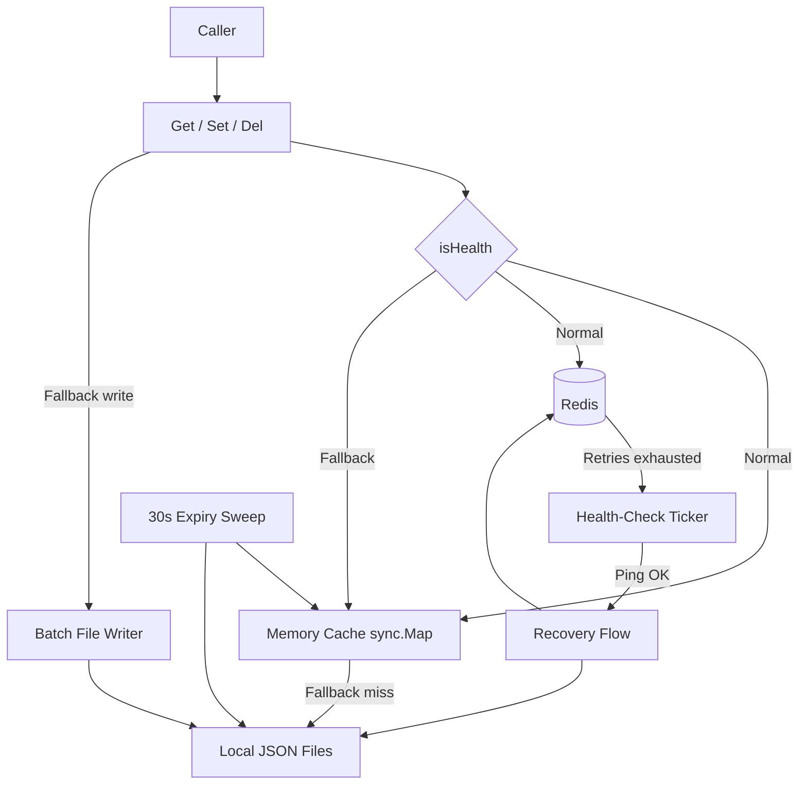

# Architecture

This page shows how the components of go-redis-fallback relate in one overview diagram.

## System Overview

## Layers

| Layer | Source | Responsibility |
|---|---|---|
| Public API | `get.go`, `set.go`, `del.go`, `instance.go` | Read the health flag and dispatch to Redis or the local path |
| Read path | `get.go` | Memory first, Redis retries, degradation, restore from files |
| Mode switch and recovery | `sync.go` | Health-check ticker, recovery resync, local file cleanup, read-repair |
| Batch file writer | `writer.go` | Queue, merge by key, timed parallel flush |
| File layout and expiry | `unit.go` | Three-level MD5-sharded paths, TTL checks |

## Cross-Cutting Principles

| Principle | Where |
|---|---|
| The memory cache is the first stop on every path; both modes check it first | `get.go:25`, `get.go:64` |
| The mode switch happens inside the failing call, so callers need no retry | `get.go:55-58`, `set.go:50-55` |
| Local files are only scratch storage during fallback and are always deleted after recovery | `sync.go:84-87` |
| TTL is stored as "write time + seconds" and recomputed on every tier's read | `unit.go:26-31` |

## Further Reading

Per-module diagrams (read path, recovery, write path), the full sequence diagram, and the state machine are in the repo's [doc/architecture.md](https://github.com/pardnchiu/go-redis-fallback/blob/main/doc/architecture.md).
