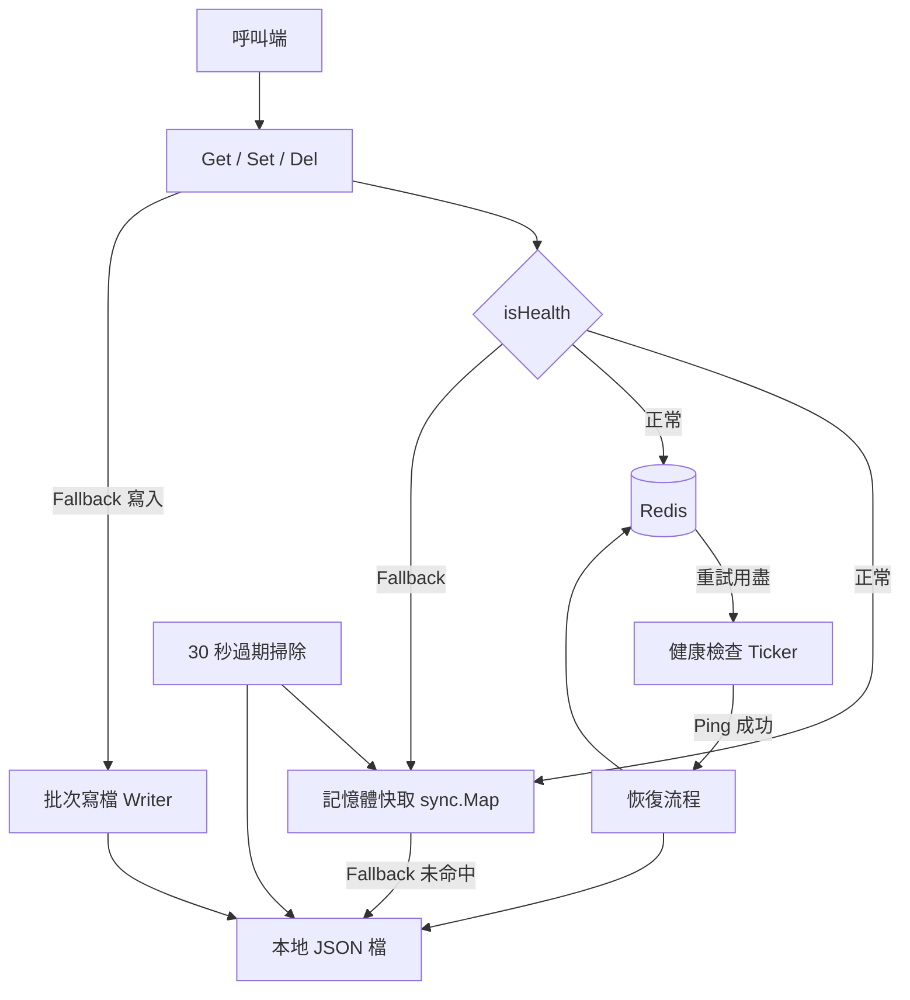

# 架構

本頁以一張概覽圖呈現 go-redis-fallback 各元件的層級關係。

## 系統概覽

## 分層

| 層 | 原始碼 | 職責 |
|---|---|---|
| 公開 API | `get.go`、`set.go`、`del.go`、`instance.go` | 讀取健康旗標，分派到 Redis 或本地路徑 |
| 讀取路徑 | `get.go` | 記憶體優先、Redis 重試、降級、從檔案還原 |
| 模式切換與恢復 | `sync.go` | 健康檢查 Ticker、恢復回灌、本地檔案清理、讀取修補 |
| 批次寫檔 | `writer.go` | 佇列、依 key 合併、定時並行落檔 |
| 檔案佈局與過期判斷 | `unit.go` | MD5 三層分片路徑、TTL 判斷 |

## 跨層原則

| 原則 | 實作位置 |
|---|---|
| 記憶體快取是每一條路徑的第一站，兩種模式都先查它 | `get.go:25`、`get.go:64` |
| 模式切換發生在失敗的那一次呼叫內，呼叫端不需重試 | `get.go:55-58`、`set.go:50-55` |
| 本地檔案只是 fallback 期間的暫存，恢復後一律刪除 | `sync.go:84-87` |
| TTL 以「寫入時間 + 秒數」儲存，每一層讀取都重新計算 | `unit.go:26-31` |

## 延伸閱讀

模組級圖表（讀取路徑、恢復、寫入路徑）、完整序列圖與狀態機見 repo 內的 [doc/architecture.zh.md](https://github.com/pardnchiu/go-redis-fallback/blob/main/doc/architecture.zh.md)。
