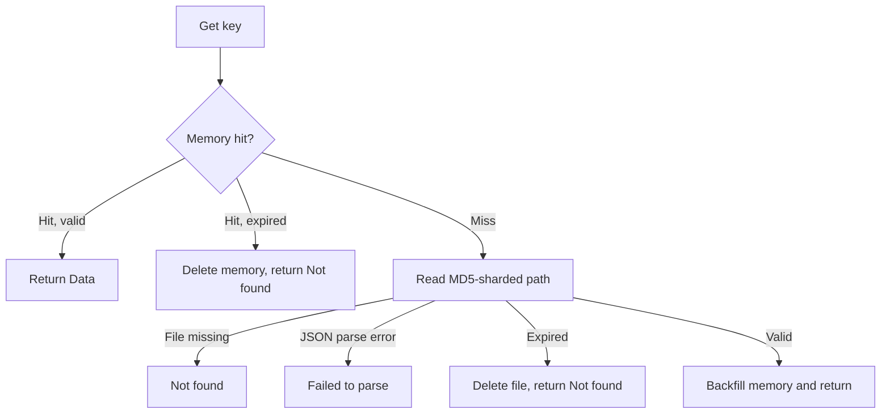

# Fallback-Mode Read

This page explains how `Get` reads from memory and local JSON files in fallback mode, and what types values restored from files have.

## Flow



## Steps

| Step | Condition | Behavior | Source |
|---|---|---|---|
| 1 | Memory hit, not expired | Return immediately | `get.go:64-75` |
| 2 | Memory hit, expired | Delete the memory entry and return `Not found`; the file is not checked and is left to the [background sweep](/read-expiry) | `get.go:68-72` |
| 3 | Memory miss | Read `{DBPath}/{DB}/{md5[0:2]}/{md5[2:4]}/{md5[4:6]}/{md5}.json` | `get.go:81-86` |
| 4 | File missing | Return `Not found` | `get.go:85-87` |
| 5 | Content is not valid `Cache` JSON | Return `Failed to parse` | `get.go:89-93` |
| 6 | Expired | Delete the file, return `Not found` | `get.go:95-100` |
| 7 | Valid | Store in the memory cache (the next read hits memory) and return `Data` | `get.go:102-106` |

## What Data Is Readable

| Data source | Readable in fallback mode |
|---|---|
| Values this instance `Set` during fallback | Yes. `Set` writes memory first and then enqueues the file write, so the value is readable before the file exists |
| Values this instance read or wrote during normal mode | Yes, still in the memory cache |
| Files written by a previous process during fallback | Yes, restored from file |
| Values that exist only in Redis and this instance never read | No; fallback mode does not touch Redis |

## Types After Restoring from File

The memory cache keeps the original Go value from write time; values restored from files are decoded by `encoding/json` into `interface{}`, so their types change:

| Value at write time | On a memory hit | Restored from file |
|---|---|---|
| `"hello"` | `string` | `string` |
| `42` | `int` | `float64` |
| `map[string]any{"uid": 1}` | `map[string]any` (`uid` is `int`) | `map[string]interface{}` (`uid` is `float64`) |
| Custom struct | The original struct | `map[string]interface{}` |

When a fixed type is required, convert with `json.Marshal` → `json.Unmarshal` into the target type instead of a direct type assertion.

### Example: Reading from File After a Restart

```go
// Process A writes while Redis is down, flushes the batch, then exits
if err := rf.Set("session:abc", map[string]any{"uid": 1}, time.Hour); err != nil {
	log.Fatal(err)
}

// Process B starts while Redis is still down → fallback mode; memory is empty, so it reads the file
value, err := rf.Get("session:abc")
if err != nil {
	log.Fatal(err)
}
uid := value.(map[string]interface{})["uid"].(float64) // float64 after restoring from file
fmt.Println(uid)
```
