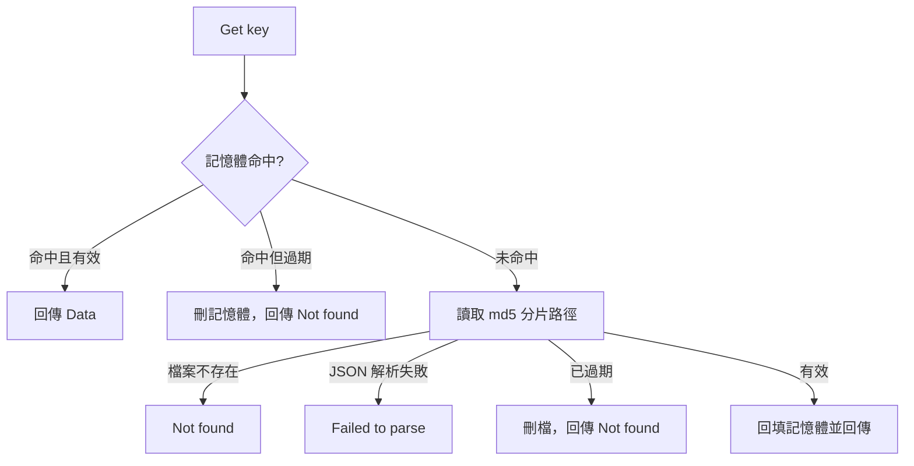

# Fallback 模式讀取

本頁說明 fallback 模式下 `Get` 如何從記憶體與本地 JSON 檔取值，以及從檔案還原的值會是什麼型別。

## 流程



## 步驟

| 步驟 | 條件 | 行為 | 原始碼 |
|---|---|---|---|
| 1 | 記憶體命中且未過期 | 立即回傳 | `get.go:64-75` |
| 2 | 記憶體命中但已過期 | 刪除記憶體項目，回傳 `Not found`；不查檔案，檔案交給[背景掃除](/zh/read-expiry) | `get.go:68-72` |
| 3 | 記憶體未命中 | 讀取 `{DBPath}/{DB}/{md5[0:2]}/{md5[2:4]}/{md5[4:6]}/{md5}.json` | `get.go:81-86` |
| 4 | 檔案不存在 | 回傳 `Not found` | `get.go:85-87` |
| 5 | 內容不是合法 `Cache` JSON | 回傳 `Failed to parse` | `get.go:89-93` |
| 6 | 已過期 | 刪除檔案，回傳 `Not found` | `get.go:95-100` |
| 7 | 有效 | 寫入記憶體快取（下一次讀取直接命中），回傳 `Data` | `get.go:102-106` |

## 讀得到哪些資料

| 資料來源 | Fallback 模式下能否讀到 |
|---|---|
| 本實例在 fallback 期間 `Set` 的值 | 能。`Set` 先寫記憶體，再排入批次寫檔，寫檔前就能讀到 |
| 本實例在正常模式期間讀寫過的值 | 能，仍在記憶體快取中 |
| 上一個程序在 fallback 期間寫出的檔案 | 能，從檔案還原 |
| 只存在於 Redis、本實例從未讀過的值 | 不能，fallback 模式不存取 Redis |

## 從檔案還原的型別

記憶體快取保存寫入時的原始 Go 值；從檔案還原的值經 `encoding/json` 解碼為 `interface{}`，型別會改變：

| 寫入時的值 | 記憶體命中時 | 從檔案還原時 |
|---|---|---|
| `"hello"` | `string` | `string` |
| `42` | `int` | `float64` |
| `map[string]any{"uid": 1}` | `map[string]any`（`uid` 為 `int`） | `map[string]interface{}`（`uid` 為 `float64`） |
| 自訂 struct | 原 struct | `map[string]interface{}` |

需要固定型別時，呼叫端應以 `json.Marshal` → `json.Unmarshal` 轉回目標型別，而非直接 type assertion。

### 範例：重啟後從檔案讀取

```go
// 程序 A 在 Redis 失聯期間寫入，批次寫檔後結束
if err := rf.Set("session:abc", map[string]any{"uid": 1}, time.Hour); err != nil {
	log.Fatal(err)
}

// 程序 B 啟動時 Redis 仍失聯 → fallback 模式；記憶體為空，改讀檔案
value, err := rf.Get("session:abc")
if err != nil {
	log.Fatal(err)
}
uid := value.(map[string]interface{})["uid"].(float64) // 從檔案還原後為 float64
fmt.Println(uid)
```
