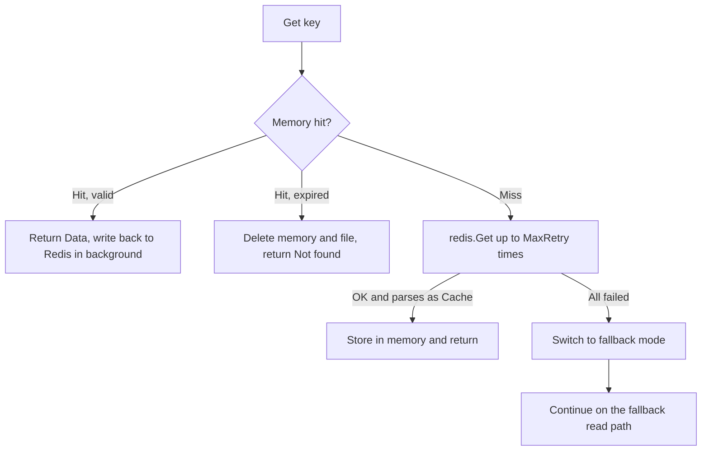

# Normal-Mode Read

This page explains which tiers `Get` checks in normal mode, when it treats Redis as failed, and how it degrades within the same call.

## Flow



## Steps

| Step | Condition | Behavior | Source |
|---|---|---|---|
| 1 | Memory hit, not expired | Return immediately and write back to Redis in a goroutine ([Read-Repair](/read-repair)) | `get.go:25-39` |
| 2 | Memory hit, expired | Delete the memory entry and the local JSON file, return `Not found` | `get.go:29-34` |
| 3 | Memory miss | Run `GET` against Redis up to `MaxRetry` times (default 3); on a parseable result, store in memory and return | `get.go:41-53` |
| 4 | Retries exhausted | Take the write lock, switch to fallback mode (starting the health check), release the lock, then call the [Fallback-Mode Read](/read-fallback-local) | `get.go:55-60` |

### Memory First

In normal mode the memory cache takes precedence over Redis. For any key this instance has written or read, `Get` returns the in-memory value without asking Redis again, so a key changed or deleted externally in Redis still reads as the old value here until it expires.

### Retry Behavior

| Item | Behavior |
|---|---|
| Interval | No wait between attempts |
| Per-attempt timeout | go-redis client defaults (the instance only sets `Addr` / `Password` / `DB`) |
| Counted as failure | Connection errors, `redis.Nil` (key missing), a value that does not parse as the `Cache` structure |

## Which Values Read Back from Redis

Step 3 parses the Redis value into the `Cache` structure (`key` / `data` / `type` / `timestamp` / `ttl`) with `json.Unmarshal`, but `Set` writes only the JSON of `Data` itself to Redis (strings have their quotes trimmed). Observed results:

| Scenario | Result |
|---|---|
| `Set` then `Get` on the same instance | Memory hit, returns normally |
| Another instance (or after a restart) calls `Get` for a string, number, or array value | Parse fails → switch to fallback → no local file → `Not found` |
| Another instance (or after a restart) calls `Get` for a map or struct value (stored as a JSON object) | The object parses as `Cache` without error; unknown fields are ignored, so `Get` returns `nil, nil` and stores that empty entry (no TTL) in memory |
| `Get` for a missing key | `redis.Nil` → switch to fallback → `Not found` |

The parse-failure and missing-key cases take the instance out of normal mode until the health check's next successful ping completes recovery. In the JSON-object case the instance stays in normal mode, but the next `Get` for that key hits the empty memory entry and [Read-Repair](/read-repair#empty-entries-overwrite-redis) writes `null` over the Redis value.

## Example

```go
value, err := rf.Get("user:1")
if err != nil {
	// key missing, expired, or the local file failed to parse
	log.Println(err)
	return
}
fmt.Println(value)
```

`Get` returns only two error messages, `Not found` and `Failed to parse`; it never returns a Redis connection error. A `nil` value with a `nil` error is possible in the JSON-object case above.
