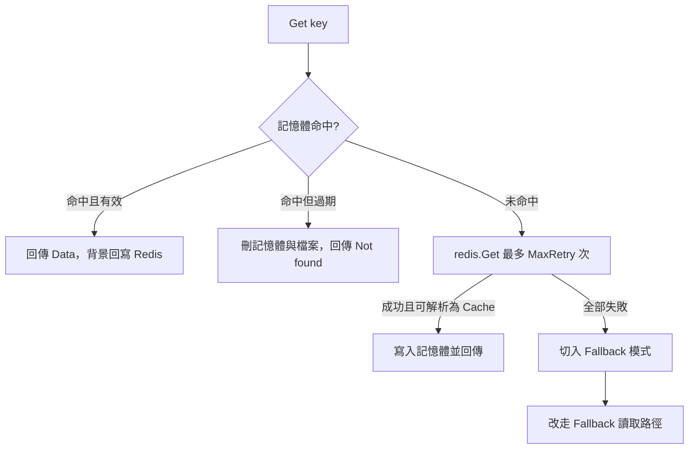

# 正常模式讀取

本頁說明正常模式下 `Get` 依序查哪幾層、何時判定 Redis 失敗，以及失敗後如何在同一次呼叫內降級。

## 流程



## 步驟

| 步驟 | 條件 | 行為 | 原始碼 |
|---|---|---|---|
| 1 | 記憶體命中且未過期 | 立即回傳，並以 goroutine 寫回 Redis（[讀取修補](/zh/read-repair)） | `get.go:25-39` |
| 2 | 記憶體命中但已過期 | 刪除記憶體項目與本地 JSON 檔，回傳 `Not found` | `get.go:29-34` |
| 3 | 記憶體未命中 | 向 Redis 執行 `GET`，最多 `MaxRetry` 次（預設 3）；成功且可解析就寫入記憶體並回傳 | `get.go:41-53` |
| 4 | 重試用盡 | 取得寫鎖、切入 fallback 模式（啟動健康檢查）、釋放鎖，接著呼叫 [Fallback 模式讀取](/zh/read-fallback-local) | `get.go:55-60` |

### 記憶體優先

正常模式下記憶體快取優先於 Redis。同一實例寫入或讀取過的鍵，`Get` 一律回傳記憶體中的值，不會再查 Redis；因此在 Redis 端被外部修改或刪除的鍵，本實例仍會讀到舊值，直到該項目過期。

### 重試行為

| 項目 | 行為 |
|---|---|
| 間隔 | 重試之間沒有等待 |
| 單次逾時 | 由 go-redis client 預設值決定（實例只設定 `Addr`／`Password`／`DB`） |
| 計為失敗的情況 | 連線錯誤、`redis.Nil`（鍵不存在）、值無法解析為 `Cache` 結構 |

## 什麼值能從 Redis 讀回

步驟 3 以 `json.Unmarshal` 把 Redis 值解析為 `Cache` 結構（`key`／`data`／`type`／`timestamp`／`ttl`），但 `Set` 寫入 Redis 的只是 `Data` 本身的 JSON（字串會去掉引號）。實測結果：

| 情境 | 結果 |
|---|---|
| 同一實例 `Set` 後 `Get` | 記憶體命中，正常回傳 |
| 另一個實例（或重啟後）`Get` 字串、數字或陣列值 | 解析失敗 → 切入 fallback → 本地無檔 → `Not found` |
| 另一個實例（或重啟後）`Get` map 或 struct 值（以 JSON 物件儲存） | 物件可無錯誤地解析為 `Cache`，未知欄位被忽略，`Get` 回傳 `nil, nil`，並把這個空項目（無 TTL）存入記憶體 |
| `Get` 不存在的鍵 | `redis.Nil` → 切入 fallback → `Not found` |

解析失敗與鍵不存在兩種情況會讓實例離開正常模式，直到健康檢查下一次 Ping 成功並完成恢復。JSON 物件的情況實例仍維持正常模式，但下一次 `Get` 同一個鍵會命中記憶體中的空項目，[讀取修補](/zh/read-repair#空項目覆寫-redis)會以 `null` 覆寫 Redis 中的值。

## 範例

```go
value, err := rf.Get("user:1")
if err != nil {
	// 鍵不存在、已過期，或本地檔案解析失敗
	log.Println(err)
	return
}
fmt.Println(value)
```

`Get` 回傳的錯誤只有 `Not found` 與 `Failed to parse` 兩種訊息，不會回傳 Redis 連線錯誤。上述 JSON 物件情況可能回傳 `nil` 值與 `nil` 錯誤。
