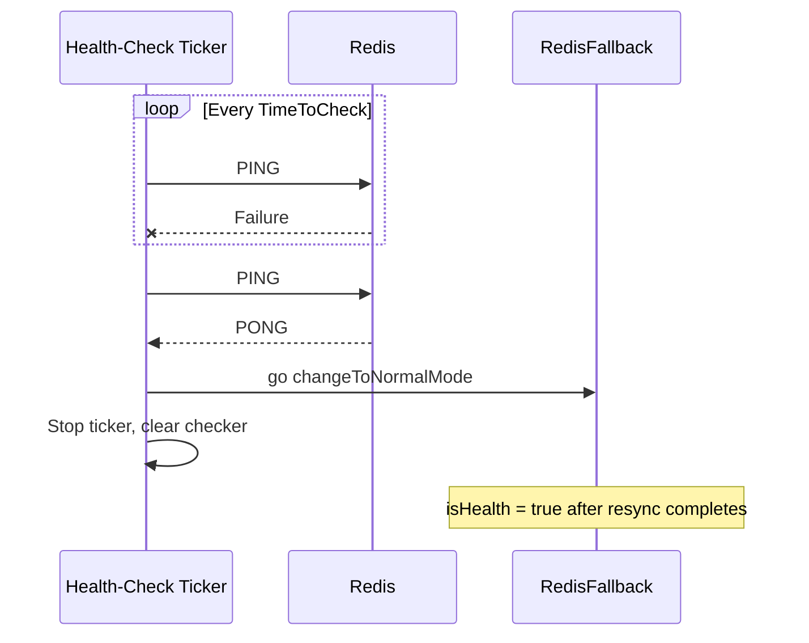

# Health Check and Mode Switch

This page explains what switches the instance into fallback mode, how the health check detects that Redis is back, and what happens between detection and returning to normal mode.

## Fallback Triggers

| Trigger | Location | Result |
|---|---|---|
| Startup ping in `New` fails | `instance.go:43-46` | Enters fallback directly |
| `Get` fails `MaxRetry` Redis reads | `get.go:55-58` | The same call continues on the local read path |
| `Set` fails `MaxRetry` Redis writes | `set.go:50-55` | The same call writes to memory and file instead |

A failed Redis delete in `Del` only returns an error; it does not switch modes.

### The Switch

`changeToFallbackMode` (`sync.go:25-48`):

1. Sets `isHealth` to `false`.
2. Returns immediately if a health-check ticker already exists, so it never starts twice.
3. Otherwise creates a ticker at `TimeToCheck` intervals (default 1 minute) that sends `PING` to Redis on each tick.

## Detecting Recovery

| Item | Behavior |
|---|---|
| Maximum detection delay | `TimeToCheck`; after Redis comes back it can take up to one interval to notice |
| How recovery runs | In a separate goroutine; the ticker stops immediately |
| Reads and writes during recovery | `isHealth` is still `false`, so `Get` / `Set` keep using the local path until the resync finishes |
| Failing again | The next read or write that exhausts its retries re-enters fallback and creates a new ticker |

## Recovery at Startup

When the startup ping in `New` succeeds, `changeToNormalMode` runs synchronously (`instance.go:47-50`): JSON files left by a previous process during fallback are loaded and resynced to Redis on this start.

The first step of `changeToNormalMode` walks `{DBPath}/{DB}`; if that directory does not exist it returns an error, `isHealth` is never set to `true`, no health check is running, and the instance stays in local mode for good. Create the directory before the first deployment; see [Getting Started](/getting-started).

## Resync Details

The full steps for loading files, writing back to Redis, and removing local files are in [Recovery Resync](/recovery-resync).
