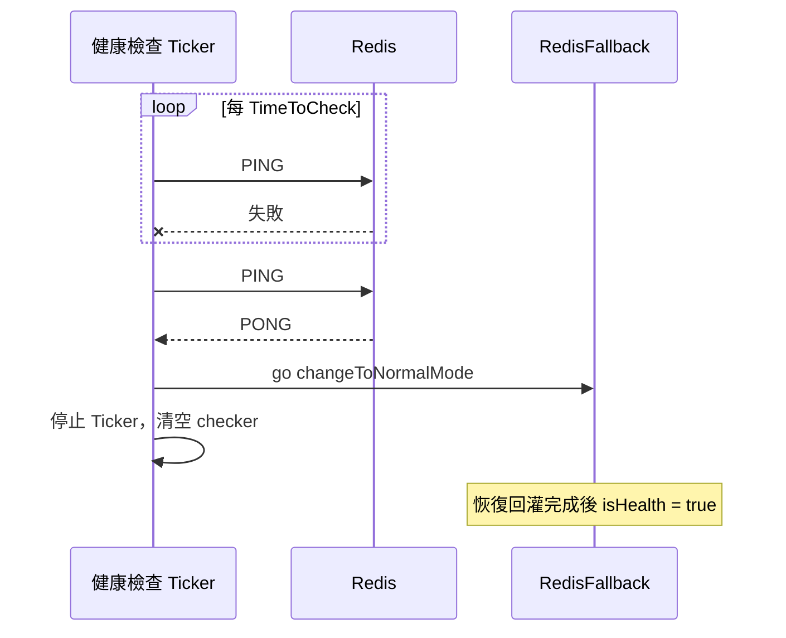

# 健康檢查與模式切換

本頁說明什麼情況會切入 fallback 模式、健康檢查如何偵測 Redis 恢復，以及從偵測到回到正常模式之間發生什麼事。

## 切入 fallback 的觸發點

| 觸發點 | 位置 | 結果 |
|---|---|---|
| `New` 啟動時 Ping 失敗 | `instance.go:43-46` | 直接進入 fallback |
| `Get` 讀 Redis 重試 `MaxRetry` 次皆失敗 | `get.go:55-58` | 同一次呼叫改走本地讀取 |
| `Set` 寫 Redis 重試 `MaxRetry` 次皆失敗 | `set.go:50-55` | 同一次呼叫改寫記憶體與檔案 |

`Del` 刪除 Redis 失敗只回傳錯誤，不會切換模式。

### 切換動作

`changeToFallbackMode`（`sync.go:25-48`）：

1. 將 `isHealth` 設為 `false`。
2. 若健康檢查 Ticker 已存在，直接返回，不會重複啟動。
3. 否則建立間隔 `TimeToCheck`（預設 1 分鐘）的 Ticker，每次觸發對 Redis 執行 `PING`。

## 偵測恢復

| 項目 | 行為 |
|---|---|
| 偵測延遲上限 | `TimeToCheck`；Redis 恢復後最晚要等一個間隔才會被發現 |
| 恢復執行方式 | 另起 goroutine 執行，Ticker 立即停止 |
| 恢復期間的讀寫 | `isHealth` 仍為 `false`，`Get`／`Set` 繼續走本地路徑，直到回灌完成 |
| 再次失敗 | 下一次讀寫重試用盡時重新切入 fallback，並建立新的 Ticker |

## 啟動時的恢復

`New` 啟動時 Ping 成功會同步執行 `changeToNormalMode`（`instance.go:47-50`）：上一個程序在 fallback 期間留下的 JSON 檔，會在這次啟動時載入並回灌 Redis。

`changeToNormalMode` 第一步走訪 `{DBPath}/{DB}`；目錄不存在時回傳錯誤，`isHealth` 不會被設為 `true`，也沒有健康檢查在跑，實例會一直停在本地模式。首次部署前先建立該目錄，見 [快速開始](/zh/getting-started)。

## 回灌細節

載入檔案、寫回 Redis、清除本地檔案的完整步驟見 [恢復回灌](/zh/recovery-resync)。
