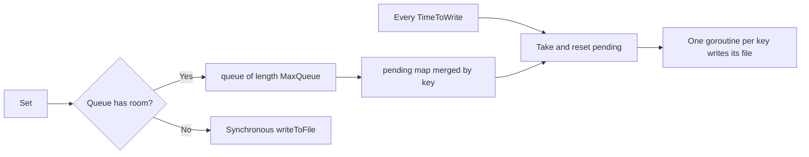

# Write Path

This page explains how `Set` and `Del` behave in each mode, and how writes during fallback are batched to disk through a queue.

## Set

| Mode | Behavior | Source |
|---|---|---|
| Normal | Write Redis with `SET` (no expiry when `TTL` is 0), up to `MaxRetry` times; on success, store in the memory cache | `set.go:33-48` |
| Normal (retries exhausted) | Switch to fallback; the same call continues with a fallback write | `set.go:50-55` |
| Fallback | Store in the memory cache, then send a `WriteRequest` to the queue | `set.go:58-68` |

When `Set` returns `nil` in fallback mode, the data is already in memory and `Get` can read it immediately; the file write happens later.

## Batch File Writes



| Item | Behavior | Source |
|---|---|---|
| Queue | Length `MaxQueue` (default 1000) | `instance.go:36` |
| Merging | Multiple writes to one key within an interval keep only the last | `writer.go:13-16` |
| Flush interval | `TimeToWrite` (default 3 seconds) | `writer.go:17-18` |
| Parallelism | One goroutine per key; the round ends when all finish | `writer.go:39-49` |
| Full queue | Does not block; writes the file synchronously and returns its error | `set.go:61-65` |
| File content | JSON of the whole `Cache` structure, mode `0644` | `writer.go:52-65` |

## Del

`Del` (`del.go:7-23`) always deletes the memory entry and the local file; in normal mode it also runs Redis `DEL` and returns an error if that fails (no mode switch, no retry). Deleting a missing key returns no error.

| Mode | Memory | Local file | Redis |
|---|---|---|---|
| Normal | Deleted | Deleted | `DEL` |
| Fallback | Deleted | Deleted | Untouched |

A key deleted during fallback still exists in Redis; the recovery resync does not replay deletes, so the key stays in Redis until it expires on its own.

## Example

```go
if err := rf.Set("user:1", map[string]any{"name": "pardn"}, 30*time.Minute); err != nil {
	// only when serialization fails, or the fallback queue is full and the synchronous file write fails
	log.Println(err)
}

if err := rf.Del("user:1"); err != nil {
	// only when Redis DEL fails in normal mode
	log.Println(err)
}
```
