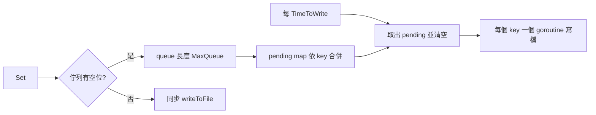

# 寫入路徑

本頁說明 `Set` 與 `Del` 在兩種模式下的行為，以及 fallback 期間寫入如何經佇列批次落檔。

## Set

| 模式 | 行為 | 原始碼 |
|---|---|---|
| 正常 | 以 `SET` 寫 Redis（`TTL` 為 0 時不設過期），最多 `MaxRetry` 次；成功後寫入記憶體快取 | `set.go:33-48` |
| 正常（重試用盡） | 切入 fallback，同一次呼叫改走 fallback 寫入 | `set.go:50-55` |
| Fallback | 寫入記憶體快取，再把 `WriteRequest` 送入佇列 | `set.go:58-68` |

`Set` 在 fallback 模式下回傳 `nil` 時，資料已在記憶體中，`Get` 立即讀得到；落檔是之後的事。

## 批次寫檔



| 項目 | 行為 | 原始碼 |
|---|---|---|
| 佇列 | 長度 `MaxQueue`（預設 1000） | `instance.go:36` |
| 合併 | 同一個 key 在一個間隔內多次寫入，只保留最後一次 | `writer.go:13-16` |
| 落檔間隔 | `TimeToWrite`（預設 3 秒） | `writer.go:17-18` |
| 並行 | 每個 key 一個 goroutine，全部完成才結束本輪 | `writer.go:39-49` |
| 佇列滿 | 不阻塞，改為同步寫檔並回傳寫檔錯誤 | `set.go:61-65` |
| 檔案內容 | 整個 `Cache` 結構的 JSON，權限 `0644` | `writer.go:52-65` |

## Del

`Del`（`del.go:7-23`）一律刪除記憶體項目與本地檔案；正常模式下另外執行 Redis `DEL`，失敗時回傳錯誤（不切換模式、不重試）。刪除不存在的鍵不會回傳錯誤。

| 模式 | 記憶體 | 本地檔 | Redis |
|---|---|---|---|
| 正常 | 刪除 | 刪除 | `DEL` |
| Fallback | 刪除 | 刪除 | 不動 |

Fallback 期間刪除的鍵在 Redis 端仍存在；恢復回灌不會補做刪除，該鍵在 Redis 會保留到自身過期為止。

## 範例

```go
if err := rf.Set("user:1", map[string]any{"name": "pardn"}, 30*time.Minute); err != nil {
	// 僅在序列化失敗，或 fallback 佇列已滿且同步寫檔失敗時發生
	log.Println(err)
}

if err := rf.Del("user:1"); err != nil {
	// 僅在正常模式下 Redis DEL 失敗時發生
	log.Println(err)
}
```
